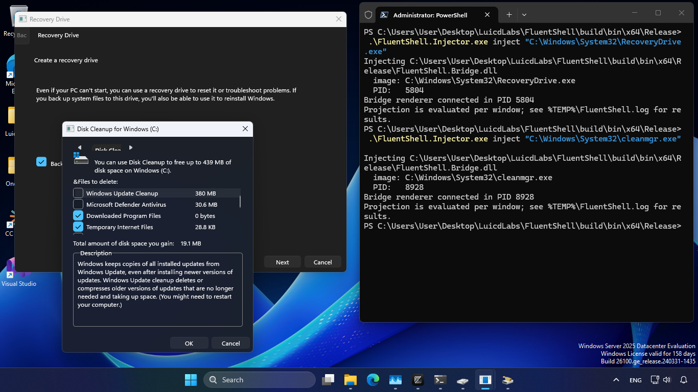

# FluentShell

FluentShell projects supported Win32 windows as real WinUI 3 windows while the original application keeps running. Native controls remain the source of truth: projected input returns to the application, and native changes update the WinUI view.

The C++ Bridge runs inside the target process. WinUI runs exclusively in a separate renderer process. Each window is admitted as a complete surface; unsupported content or a failed projection restores the original native window.



## Quick start

Build on an x64 Windows machine with:

- Visual Studio and the MSVC v145 toolchain for x64 and Win32.
- Windows SDK 10.0.26100.
- .NET 8 SDK or newer. The framework-dependent GUI also requires the .NET 8 Desktop Runtime.

From the repository root:

```powershell
.\build.ps1 -Configuration Release
.\test.ps1 -Configuration Release
.\build\bin\x64\Release\Gui\FluentShell.Gui.exe
```

The build restores dependencies, builds both native architectures, and publishes the renderer and GUI into separate folders. The renderer includes its .NET and Windows App SDK runtime dependencies.

## Use FluentShell

### Global apply through the GUI

1. Launch `Gui\FluentShell.Gui.exe` from the production output.
2. Select **Start global apply**. On first use, or when the warning changes, read the warning and type `I ACCEPT THE RISK` to accept it.
3. Inspect the application and window lists. Restore individual projected windows or use **Stop and restore all windows** to end global apply.

The watcher periodically considers eligible applications in the current Windows session and at the injector's integrity level. It runs only while enabled; it does not elevate applications or start automatically at logon. The panic shortcut is **Ctrl+Alt+Shift+F12**. Closing the GUI or losing the watcher also restores projections through the Bridge's watcher lease.

Warning acceptance and application opt-outs are stored for the current user. Acceptance is bound to the exact warning's SHA-256. Both `watch` and `watch --dry-run` require that acceptance, and the watcher refuses to start if its panic shortcut is unavailable.

An application opt-out stops future watcher injection attempts and restores its currently listed projected windows. An already injected ordinary Bridge can still discover new windows in that process; restart the application for a clean opt-out. A window restored individually remains native for that HWND's lifetime, including after global apply resumes.

### Inject one running application

Open PowerShell in `build\bin\x64\Release` and select an existing executable by its absolute image path:

```powershell
$image = 'C:\Path\To\Application.exe'
.\FluentShell.Injector.exe inject $image --pid 1234
```

`--pid` is required when several running processes match the image. When exactly one matches, it may be omitted. To pin the executable's contents:

```powershell
$hash = (Get-FileHash -LiteralPath $image -Algorithm SHA256).Hash
.\FluentShell.Injector.exe inject $image --pid 1234 --sha256 $hash
```

The injector resolves the image through a file handle and compares it with the selected process's canonical image path. Name-only injection and `--signer` are unsupported. The x64 injector automatically delegates 32-bit targets to the binaries under `x86\`; both native architectures use the same x64 renderer.

The CLI also exposes:

```text
FluentShell.Injector.exe inject <absolute-image-path> [--pid <pid>] [--sha256 <hex>]
FluentShell.Injector.exe watch [--dry-run]
FluentShell.Injector.exe watch-warning
```

`watch-warning` prints the current warning. After GUI consent, `watch --dry-run` reports eligibility without injecting applications.

### Target restrictions and Explorer dialogs

The process policy excludes designated operating-system, shell, security, XAML, and FluentShell host processes. Ordinary Bridge sessions also refuse targets that already host XAML. Injection requires a matching session and integrity level.

Manual injection continues to deny Explorer. Global apply has a narrow exception for eligible top-level `#32770` dialogs in the actual system Explorer, authorized by a live watcher grant tied to its PID and creation time. Explorer's desktop, taskbar, folder windows, and XAML roots retain their native UI. The restricted Explorer session ends when its grant disappears.

See the [global GUI design](docs/goals/win32-to-winui-translation/GLOBAL-GUI-DESIGN.md) and the implemented [process policy](src/Common/ProcessPolicy.h) for the exact boundary.

## Projection coverage

Support is determined from each control's current class, styles, state, geometry, and available semantic contract. A supported control family does not imply that every style or every window in an application will project.

| Control family | Supported shapes |
| --- | --- |
| Text and pictures | Standard Static text, separators, bounded decorations, icons, bitmaps, and picture buttons. |
| Buttons and toggles | Push buttons, checkboxes, three-state controls, radio buttons, group boxes, supported command links and split buttons, and bounded owner-draw button faces. |
| Text entry | Edit and password controls, cue banners, and constrained editable RichEdit content. Read-only RichEdit can carry supported formatted paragraphs and runs. |
| Choice controls and links | Dropdown and editable ComboBox, ComboBoxEx, ListBox, multi-selection lists, bounded owner-draw faces, and supported SysLink markup. |
| ListView | Report, large-icon, small-icon, list, and tile modes; supported column ordering, icons, checkboxes, groups, context menus, and native label-edit sessions. Large report lists use the bounded paging contract described below. |
| TreeView | Hierarchy, selection, expansion, per-item icons, supported state images and checkboxes, context menus, and native label editing. |
| Tabs and ranges | Textual top tabs, including fixed-width and multiline tabs; sliders, spin controls, and supported stock date/time picker formats. |
| Toolbars and status bars | Supported toolbar buttons, icons, toggle and radio groups, dropdown actions, accessible labels, and textual status parts. |
| Progress | Horizontal and vertical progress bars with determinate or marquee presentation. Determinate values retain a read-only range contract. |
| Dialog APIs | Supported MessageBox and TaskDialog layouts, buttons, links, verification, and expansion controls. |
| Containers and MDI | Supported dialog containers, MDI clients and child frames, geometrically proven pane containers, projected splitters that resize native panes, scrollbars, and bounded painted chrome. |
| Accessible and system content | Bounded MSAA islands and capability-validated DirectUI surfaces; specialized adapters for supported MMC menu/message/document views, Disk Management views, and Performance Monitor charts. |

Specialized system adapters validate their native backing and capabilities. The DirectUI application engine is restricted to eligible Microsoft-signed canonical System32 images. These adapters establish support for proven surfaces rather than whole-application compatibility.

Unsupported formatting, uncontracted custom drawing, unreadable virtual state, unsupported embedded content, layered or nonrectangular windows, and custom non-client rendering keep the entire window native. The [control adapter roadmap](docs/goals/win32-to-winui-translation/CONTROL-ADAPTER-ROADMAP.md) records the support boundary and expansion plan.

### Large report lists and capture limits

Stored report ListViews above 4,096 rows and eligible owner-data reports above 512 rows use a page of 48 to 192 rows sized from the native viewport. Selection and focus indexes remain absolute. Scrolling beyond the current page requests another native capture, and panel padding represents the missing rows in the complete scroll extent.

Windowed reports require readable columns and exclude groups, checkboxes, and label editing, which need the complete per-item contract. Where the native control exposes stable item IDs, Bridge-private witnesses also detect same-label replacement or reordering. Indexed gestures are checked against the published native snapshot before execution.

The protocol bounds resource use:

| Resource | Limit |
| --- | --- |
| Projected nodes per surface | 512 |
| Child HWNDs considered during discovery | 8,192 |
| JSON payload per frame | 4 MiB |
| Complete item arrays | 4,096 entries |
| Native row count for a windowed report | 16,777,216 |

Hidden property pages and absorbed implementation HWNDs consume discovery capacity but do not consume projected-node capacity. Other text, image, menu, and geometry budgets still apply. The native row-count limit is a protocol bound; the acceptance harness exercises a 10,000-row report.

## Architecture

```text
Native application: HWND/control tree and canonical state
                 | snapshots and patches
                 v
FluentShell.Bridge.dll -- versioned named pipe -- FluentShell.Renderer.exe
    injected C++                                    separate WinUI 3 process
                 ^ semantic actions and native results
```

- **Bridge:** captures controls, executes native operations on their owning GUI threads, authenticates the renderer, and owns rollback.
- **Renderer:** creates real XAML controls, maintains typed view models, and forwards user intent through the protocol.
- **GUI and watcher:** manage explicit global-apply consent, target eligibility, projection status, and restoration.

HWND projection uses a two-phase commit. The replacement is prepared hidden and cloaked, checked through UI Automation, and synchronized with a native revision acknowledged by the renderer. A provisional commit shows the replacement while input remains gated. The Bridge verifies visibility, ordering, native cloaking, and committed UIA evidence before enabling interaction. Supported MessageBox and TaskDialog calls use virtual WinUI surfaces and return their results through the Bridge.

An application may reject an operation, such as a label edit or close request. FluentShell reports that refusal and retains the projection with canonical state. Unsupported content, protocol faults, failed validation, capture failures, or renderer loss restore the complete native surface.

The current protocol is **1.42**. Frames use a 32-byte little-endian `FLSH` header and JSON payloads. IDs, generations, and revisions use canonical decimal strings; HWNDs use hexadecimal strings. The Bridge authenticates the renderer's process identity, creation time, logon SID, and session nonce. The contract lives in the [protocol schema](src/Protocol/protocol-v1.schema.json), with shared examples under [ProtocolFixtures](tests/ProtocolFixtures).

## Performance and reliability

- A changed `Items` collection publishes one complete reset. A regression test updates 4,000 entries with one collection notification instead of a reset followed by 4,000 additions.
- Coupled ListView, TreeView, toolbar, status, link, and tab updates coalesce necessary presenter rebuilds after a canonical transaction. Completion is synchronous so readiness checks observe the finished state.
- Identical bitmap payloads share a per-UI-thread cache limited to 256 entries and 32 MiB of retained pixels and base64 keys. This bounds cache retention rather than total renderer memory.
- Quiet reconciliation skips payload copies. Regular HWND recapture builds its replacement directly, and unchanged renderer row/detail data retains its existing storage.
- Source-thread work shares one deadline across queuing and execution. Cancellation interrupts both acknowledgement and completion waits; sent notifications can still complete across GUI threads.
- Ordinary HWND UIA validation caches descendant identities first, then obtains full details for projected nodes and the viewport. Application adapters and decoration checks retain complete subtree detail where their validation requires it.
- Large report pages use measured panel padding for their scroll extent and retry offset restoration after layout. Complete report lists without groups or checkboxes retain the default ItemsStackPanel virtualization.

## Build and output layout

```powershell
.\build.ps1 -Configuration Release
.\build.ps1 -Configuration Debug
.\build.ps1 -RestoreOnly
.\build.ps1 -Configuration Debug -CoreOnly
```

`Debug` and `Release` are the supported configurations. `-CoreOnly` builds the native projects without restoring or publishing the renderer and GUI; a full build is required for projection acceptance.

The selected configuration's production output is cleared before building. Keep the published folder layout together:

```text
build\bin\x64\Release\
  FluentShell.Injector.exe
  FluentShell.Bridge.dll
  LegacyDialogHost.exe
  Gui\
    FluentShell.Gui.exe
    ... GUI dependencies ...
  Renderer\
    FluentShell.Renderer.exe
    ... .NET, WinUI, and Windows App SDK runtime dependencies ...
  x86\
    FluentShell.Injector.exe
    FluentShell.Bridge.dll
```

WinUI and Windows App SDK payloads stay under `Renderer\`. The injected Bridge does not import or initialize those runtimes.

## Validation

Run all suites and production gates from the repository root:

```powershell
.\test.ps1 -Configuration Release
```

The script runs the renderer and GUI C# tests, builds and runs the native HWND tests, and checks both Bridge architectures' imports and exports, payload placement, injector CLI, and global-apply guardrails.

For the C# development loop:

```powershell
dotnet test tests\FluentShell.Renderer.Tests\FluentShell.Renderer.Tests.csproj `
    --configuration Debug -p:FluentShellTestBuild=true
```

`FluentShellTestBuild=true` keeps test output separate from the production payload. Native tests must run from the repository root to resolve shared fixtures.

### Automated projection acceptance

After a full build:

```powershell
powershell -NoProfile -File .\tools\Test-ProjectionCoverage.ps1 -Configuration Release
```

The harness launches its own `LegacyDialogHost.exe --coverage` target and renderer. It checks a genuine XAML projection containing 10,000 stored rows, fixed-width tabs, both vertical progress shapes, and 1,024 hidden HWNDs. It verifies native timer patches, tab selection, native row/state updates, scrolling beyond the captured row page, and absolute row selection, then closes the processes it created.

### Interactive acceptance

From the production output directory:

```powershell
$target = (Resolve-Path .\LegacyDialogHost.exe).Path
$process = Start-Process -FilePath $target -PassThru
.\FluentShell.Injector.exe inject $target --pid $process.Id
```

The standard oracle exercises controls, native timer updates, translated MessageBox and TaskDialog results, close vetoes, and restoration after an unsupported child appears. Start it with `--mdi` for MDI frames or `--coverage` for the expanded report/tab/progress surface, then inject that process in the same way.

### Diagnostics

| Component | Log |
| --- | --- |
| Bridge | `%TEMP%\FluentShell.log` |
| Renderer | `%TEMP%\FluentShell.Renderer.log` |
| Acceptance host | `%TEMP%\FluentShell.LegacyDialogHost.log` |

Bridge logs identify capture, gate, commit, and rollback outcomes. `Projection gate rejected surface:` names the rejecting stage. Renderer logs include revisions, actions, layout, and scroll diagnostics.

## Development references

- [Translation plan and invariants](docs/goals/win32-to-winui-translation/PLAN.md)
- [Control adapter roadmap](docs/goals/win32-to-winui-translation/CONTROL-ADAPTER-ROADMAP.md)
- [DirectUI application adapters](docs/goals/win32-to-winui-translation/DIRECTUI-APPLICATION-ADAPTERS.md)
- [Global GUI design](docs/goals/win32-to-winui-translation/GLOBAL-GUI-DESIGN.md)
- [MMC validation matrix](docs/goals/win32-to-winui-translation/MMC-VALIDATION-MATRIX.md)
- [Native press behavior and evidence](docs/goals/win32-to-winui-translation/NATIVE-PRESS-EVIDENCE.md)

`ref_src` is read-only reference material. WinUIShell informs the IPC and lifetime design; its reflection RPC implementation is not copied. The GPL-licensed modernizer sample is used for behavioral research and contributes no copied implementation.
